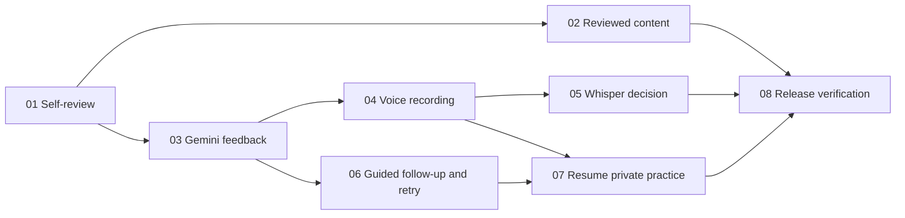

# Implementation order: free-quota voice Mock Interviews

Status: design and eight-ticket breakdown approved on 11 October 2026. All eight issues are published on GitHub with ready-for-agent labels and verified native blocking edges. Implementation has not started. This document does not authorize production load, merge or deployment.

## Source and tracker

Work from `D:\Job Hunt`. Read [the accepted design](mock-interview-design.md), [Gemini evidence](mock-interview-provider-research.md), [Whisper evidence](mock-interview-transcription-research.md), [CONTEXT.md](../CONTEXT.md) and ADRs 0010–0012. The configured tracker is [GitHub](https://github.com/fahim36/ChickenKiller/issues); linked local ticket copies make the commands directly usable. Read the live issue and comments at execution time and reconcile any subsequent changes. No parent issue was closed or modified.

## Recommended order

**01 → 02 → 03 → 04 → 05 → 06 → 07 → 08**

This is a convenient order for one developer, not a forced linear dependency chain. Ticket 02 can run after 01 alongside provider work. Ticket 06 can run after 03 with typed responses and does not depend on voice or Whisper. Ticket 05 ends in a documented Whisper enable/disable decision; benchmark failure is a valid completed decision with Gemini audio, not an indefinite blocker.

| Step | GitHub issue | Ticket path | Genuine blockers | Completion demo |
| --- | --- | --- | --- | --- |
| 1 | [#21](https://github.com/fahim36/ChickenKiller/issues/21) | [01 · Start a private Mock Interview with reviewed self-review](<D:/Job Hunt/.scratch/mock-interviews/issues/01-reviewed-self-review-session.md>) | None | Usable eligible-topic self-review, four seed prompts and private expiring history. |
| 2 | [#22](https://github.com/fahim36/ChickenKiller/issues/22) | [02 · Publish 16 reviewed Interview Prompts across the four Stacks](<D:/Job Hunt/.scratch/mock-interviews/issues/02-sixteen-reviewed-interview-prompts.md>) | 01 / #21 | 16 imported reviewed prompts and Admin coverage across all four Stacks. |
| 3 | [#23](https://github.com/fahim36/ChickenKiller/issues/23) | [03 · Give confirmed responses bounded Gemini feedback with the Learner's own key](<D:/Job Hunt/.scratch/mock-interviews/issues/03-own-key-gemini-feedback.md>) | 01 / #21 | Own-key consented feedback, reviewed follow-up selection and bounded request accounting. |
| 4 | [#24](https://github.com/fahim36/ChickenKiller/issues/24) | [04 · Record a voice response, confirm its transcript and receive feedback](<D:/Job Hunt/.scratch/mock-interviews/issues/04-record-confirm-voice-response.md>) | 03 / #23 | Record, play back, transcribe, confirm/correct and receive feedback with temporary-audio cleanup. |
| 5 | [#25](https://github.com/fahim36/ChickenKiller/issues/25) | [05 · Benchmark Whisper and select a safe transcription path for voice practice](<D:/Job Hunt/.scratch/mock-interviews/issues/05-whisper-benchmark-and-voice-path.md>) | 04 / #24 | Measured Whisper decision and safe selected transcription path; Gemini remains available if the gate fails. |
| 6 | [#26](https://github.com/fahim36/ChickenKiller/issues/26) | [06 · Complete guided scenarios with a reviewed follow-up and practice retry](<D:/Job Hunt/.scratch/mock-interviews/issues/06-guided-followup-and-practice-retry.md>) | 03 / #23 | Guided follow-ups, optional practice retry and evidence-based session suggestions. |
| 7 | [#27](https://github.com/fahim36/ChickenKiller/issues/27) | [07 · Resume private practice and pending feedback within retention and quota limits](<D:/Job Hunt/.scratch/mock-interviews/issues/07-resume-private-practice-safely.md>) | 04 / #24, 06 / #26 | Private resume/history and manual pending-feedback retries within retention/budget rules. |
| 8 | [#28](https://github.com/fahim36/ChickenKiller/issues/28) | [08 · Verify the complete free-quota Mock Interview release](<D:/Job Hunt/.scratch/mock-interviews/issues/08-verify-mock-interview-release.md>) | 02 / #22, 05 / #25, 07 / #27 | Full-flow verification, measured limitations, review and operation/rollout documentation. |

## Dependency map



## Execution rules

- Implement on a dedicated `codex/mock-interviews` branch after selecting and recording the baseline. Current content-health work is on a separate feature branch; do not assume it has merged or silently merge it. Ensure the accepted design/ADRs and required features are available. Admin coverage may be independent if Content Health is unavailable.
- Before a ticket starts, its real blockers must be verified complete and their changes present in the checkout. Ready labels do not override open blocking edges. Record evidence and commit each verified ticket before advancing.
- Preserve unrelated scratch files and changes. Run focused meaningful checks per ticket and required full checks for final integration. Do not run API tests concurrently against the shared test database.
- Every intermediate slice is usable or verifiable: self-review first; privacy/retention with the first stored response; accounting before provider use; audio cleanup with the first recording. Final verification cannot defer these safeguards.
- Normal tests/CI use mocked providers. Whisper measurements use isolated/staging hardware or explicitly authorized production benchmarks. Publishing tickets does not authorize production load or deployment.
- Only the enabled consenting learner’s Gemini key serves interviews, without Admin/CLI fallback. Do not claim key attestation enforces billing or Whisper has zero hosting cost.

## Commands per ticket

Paste the Codex chat command in a chat opened on this project, or run the PowerShell command for an interactive Codex CLI session. These are prompts, not application commands. Single quotes around the PowerShell prompt preserve the literal `$implement` skill name. Breakdown approval is complete; implementation must still be requested. Check current skill, live issue and repository guidance at execution time.

### Step 1: ticket 01 — Start a private Mock Interview with reviewed self-review

**Ticket path:** [D:\Job Hunt\.scratch\mock-interviews\issues\01-reviewed-self-review-session.md](<D:/Job Hunt/.scratch/mock-interviews/issues/01-reviewed-self-review-session.md>)

**GitHub issue:** [#21](https://github.com/fahim36/ChickenKiller/issues/21).

**Blocked by:** None.

Codex chat command:

```text
$implement Implement only approved Mock Interview ticket 01 from "D:\Job Hunt\.scratch\mock-interviews\issues\01-reviewed-self-review-session.md". Read its live GitHub issue https://github.com/fahim36/ChickenKiller/issues/21 and comments. Read "D:\Job Hunt\docs\mock-interview-design.md", CONTEXT.md, ADRs 0010-0012 and applicable repository instructions. Verify blockers are complete and their changes are present in this checkout. Meet all acceptance criteria, run appropriate focused checks, review the change and commit only this ticket on codex/mock-interviews. Preserve unrelated changes. Production merge, deployment, paid provider spending and production load tests require separate authorization.
```

PowerShell command:

```powershell
codex -C 'D:\Job Hunt' '$implement Implement only approved Mock Interview ticket 01 from "D:\Job Hunt\.scratch\mock-interviews\issues\01-reviewed-self-review-session.md". Read its live GitHub issue https://github.com/fahim36/ChickenKiller/issues/21 and comments. Read "D:\Job Hunt\docs\mock-interview-design.md", CONTEXT.md, ADRs 0010-0012 and applicable repository instructions. Verify blockers are complete and their changes are present in this checkout. Meet all acceptance criteria, run appropriate focused checks, review the change and commit only this ticket on codex/mock-interviews. Preserve unrelated changes. Production merge, deployment, paid provider spending and production load tests require separate authorization.'
```

### Step 2: ticket 02 — Publish 16 reviewed Interview Prompts across the four Stacks

**Ticket path:** [D:\Job Hunt\.scratch\mock-interviews\issues\02-sixteen-reviewed-interview-prompts.md](<D:/Job Hunt/.scratch/mock-interviews/issues/02-sixteen-reviewed-interview-prompts.md>)

**GitHub issue:** [#22](https://github.com/fahim36/ChickenKiller/issues/22).

**Blocked by:** 01.

Codex chat command:

```text
$implement Implement only approved Mock Interview ticket 02 from "D:\Job Hunt\.scratch\mock-interviews\issues\02-sixteen-reviewed-interview-prompts.md". Read its live GitHub issue https://github.com/fahim36/ChickenKiller/issues/22 and comments. Read "D:\Job Hunt\docs\mock-interview-design.md", CONTEXT.md, ADRs 0010-0012 and applicable repository instructions. Verify blockers are complete and their changes are present in this checkout. Meet all acceptance criteria, run appropriate focused checks, review the change and commit only this ticket on codex/mock-interviews. Preserve unrelated changes. Production merge, deployment, paid provider spending and production load tests require separate authorization.
```

PowerShell command:

```powershell
codex -C 'D:\Job Hunt' '$implement Implement only approved Mock Interview ticket 02 from "D:\Job Hunt\.scratch\mock-interviews\issues\02-sixteen-reviewed-interview-prompts.md". Read its live GitHub issue https://github.com/fahim36/ChickenKiller/issues/22 and comments. Read "D:\Job Hunt\docs\mock-interview-design.md", CONTEXT.md, ADRs 0010-0012 and applicable repository instructions. Verify blockers are complete and their changes are present in this checkout. Meet all acceptance criteria, run appropriate focused checks, review the change and commit only this ticket on codex/mock-interviews. Preserve unrelated changes. Production merge, deployment, paid provider spending and production load tests require separate authorization.'
```

### Step 3: ticket 03 — Give confirmed responses bounded Gemini feedback with the Learner's own key

**Ticket path:** [D:\Job Hunt\.scratch\mock-interviews\issues\03-own-key-gemini-feedback.md](<D:/Job Hunt/.scratch/mock-interviews/issues/03-own-key-gemini-feedback.md>)

**GitHub issue:** [#23](https://github.com/fahim36/ChickenKiller/issues/23).

**Blocked by:** 01.

Codex chat command:

```text
$implement Implement only approved Mock Interview ticket 03 from "D:\Job Hunt\.scratch\mock-interviews\issues\03-own-key-gemini-feedback.md". Read its live GitHub issue https://github.com/fahim36/ChickenKiller/issues/23 and comments. Read "D:\Job Hunt\docs\mock-interview-design.md", CONTEXT.md, ADRs 0010-0012 and applicable repository instructions. Verify blockers are complete and their changes are present in this checkout. Meet all acceptance criteria, run appropriate focused checks, review the change and commit only this ticket on codex/mock-interviews. Preserve unrelated changes. Production merge, deployment, paid provider spending and production load tests require separate authorization.
```

PowerShell command:

```powershell
codex -C 'D:\Job Hunt' '$implement Implement only approved Mock Interview ticket 03 from "D:\Job Hunt\.scratch\mock-interviews\issues\03-own-key-gemini-feedback.md". Read its live GitHub issue https://github.com/fahim36/ChickenKiller/issues/23 and comments. Read "D:\Job Hunt\docs\mock-interview-design.md", CONTEXT.md, ADRs 0010-0012 and applicable repository instructions. Verify blockers are complete and their changes are present in this checkout. Meet all acceptance criteria, run appropriate focused checks, review the change and commit only this ticket on codex/mock-interviews. Preserve unrelated changes. Production merge, deployment, paid provider spending and production load tests require separate authorization.'
```

### Step 4: ticket 04 — Record a voice response, confirm its transcript and receive feedback

**Ticket path:** [D:\Job Hunt\.scratch\mock-interviews\issues\04-record-confirm-voice-response.md](<D:/Job Hunt/.scratch/mock-interviews/issues/04-record-confirm-voice-response.md>)

**GitHub issue:** [#24](https://github.com/fahim36/ChickenKiller/issues/24).

**Blocked by:** 03.

Codex chat command:

```text
$implement Implement only approved Mock Interview ticket 04 from "D:\Job Hunt\.scratch\mock-interviews\issues\04-record-confirm-voice-response.md". Read its live GitHub issue https://github.com/fahim36/ChickenKiller/issues/24 and comments. Read "D:\Job Hunt\docs\mock-interview-design.md", CONTEXT.md, ADRs 0010-0012 and applicable repository instructions. Verify blockers are complete and their changes are present in this checkout. Meet all acceptance criteria, run appropriate focused checks, review the change and commit only this ticket on codex/mock-interviews. Preserve unrelated changes. Production merge, deployment, paid provider spending and production load tests require separate authorization.
```

PowerShell command:

```powershell
codex -C 'D:\Job Hunt' '$implement Implement only approved Mock Interview ticket 04 from "D:\Job Hunt\.scratch\mock-interviews\issues\04-record-confirm-voice-response.md". Read its live GitHub issue https://github.com/fahim36/ChickenKiller/issues/24 and comments. Read "D:\Job Hunt\docs\mock-interview-design.md", CONTEXT.md, ADRs 0010-0012 and applicable repository instructions. Verify blockers are complete and their changes are present in this checkout. Meet all acceptance criteria, run appropriate focused checks, review the change and commit only this ticket on codex/mock-interviews. Preserve unrelated changes. Production merge, deployment, paid provider spending and production load tests require separate authorization.'
```

### Step 5: ticket 05 — Benchmark Whisper and select a safe transcription path for voice practice

**Ticket path:** [D:\Job Hunt\.scratch\mock-interviews\issues\05-whisper-benchmark-and-voice-path.md](<D:/Job Hunt/.scratch/mock-interviews/issues/05-whisper-benchmark-and-voice-path.md>)

**GitHub issue:** [#25](https://github.com/fahim36/ChickenKiller/issues/25).

**Blocked by:** 04.

Codex chat command:

```text
$implement Implement only approved Mock Interview ticket 05 from "D:\Job Hunt\.scratch\mock-interviews\issues\05-whisper-benchmark-and-voice-path.md". Read its live GitHub issue https://github.com/fahim36/ChickenKiller/issues/25 and comments. Read "D:\Job Hunt\docs\mock-interview-design.md", CONTEXT.md, ADRs 0010-0012 and applicable repository instructions. Verify blockers are complete and their changes are present in this checkout. Meet all acceptance criteria, run appropriate focused checks, review the change and commit only this ticket on codex/mock-interviews. Preserve unrelated changes. Production merge, deployment, paid provider spending and production load tests require separate authorization.
```

PowerShell command:

```powershell
codex -C 'D:\Job Hunt' '$implement Implement only approved Mock Interview ticket 05 from "D:\Job Hunt\.scratch\mock-interviews\issues\05-whisper-benchmark-and-voice-path.md". Read its live GitHub issue https://github.com/fahim36/ChickenKiller/issues/25 and comments. Read "D:\Job Hunt\docs\mock-interview-design.md", CONTEXT.md, ADRs 0010-0012 and applicable repository instructions. Verify blockers are complete and their changes are present in this checkout. Meet all acceptance criteria, run appropriate focused checks, review the change and commit only this ticket on codex/mock-interviews. Preserve unrelated changes. Production merge, deployment, paid provider spending and production load tests require separate authorization.'
```

### Step 6: ticket 06 — Complete guided scenarios with a reviewed follow-up and practice retry

**Ticket path:** [D:\Job Hunt\.scratch\mock-interviews\issues\06-guided-followup-and-practice-retry.md](<D:/Job Hunt/.scratch/mock-interviews/issues/06-guided-followup-and-practice-retry.md>)

**GitHub issue:** [#26](https://github.com/fahim36/ChickenKiller/issues/26).

**Blocked by:** 03.

Codex chat command:

```text
$implement Implement only approved Mock Interview ticket 06 from "D:\Job Hunt\.scratch\mock-interviews\issues\06-guided-followup-and-practice-retry.md". Read its live GitHub issue https://github.com/fahim36/ChickenKiller/issues/26 and comments. Read "D:\Job Hunt\docs\mock-interview-design.md", CONTEXT.md, ADRs 0010-0012 and applicable repository instructions. Verify blockers are complete and their changes are present in this checkout. Meet all acceptance criteria, run appropriate focused checks, review the change and commit only this ticket on codex/mock-interviews. Preserve unrelated changes. Production merge, deployment, paid provider spending and production load tests require separate authorization.
```

PowerShell command:

```powershell
codex -C 'D:\Job Hunt' '$implement Implement only approved Mock Interview ticket 06 from "D:\Job Hunt\.scratch\mock-interviews\issues\06-guided-followup-and-practice-retry.md". Read its live GitHub issue https://github.com/fahim36/ChickenKiller/issues/26 and comments. Read "D:\Job Hunt\docs\mock-interview-design.md", CONTEXT.md, ADRs 0010-0012 and applicable repository instructions. Verify blockers are complete and their changes are present in this checkout. Meet all acceptance criteria, run appropriate focused checks, review the change and commit only this ticket on codex/mock-interviews. Preserve unrelated changes. Production merge, deployment, paid provider spending and production load tests require separate authorization.'
```

### Step 7: ticket 07 — Resume private practice and pending feedback within retention and quota limits

**Ticket path:** [D:\Job Hunt\.scratch\mock-interviews\issues\07-resume-private-practice-safely.md](<D:/Job Hunt/.scratch/mock-interviews/issues/07-resume-private-practice-safely.md>)

**GitHub issue:** [#27](https://github.com/fahim36/ChickenKiller/issues/27).

**Blocked by:** 04, 06.

Codex chat command:

```text
$implement Implement only approved Mock Interview ticket 07 from "D:\Job Hunt\.scratch\mock-interviews\issues\07-resume-private-practice-safely.md". Read its live GitHub issue https://github.com/fahim36/ChickenKiller/issues/27 and comments. Read "D:\Job Hunt\docs\mock-interview-design.md", CONTEXT.md, ADRs 0010-0012 and applicable repository instructions. Verify blockers are complete and their changes are present in this checkout. Meet all acceptance criteria, run appropriate focused checks, review the change and commit only this ticket on codex/mock-interviews. Preserve unrelated changes. Production merge, deployment, paid provider spending and production load tests require separate authorization.
```

PowerShell command:

```powershell
codex -C 'D:\Job Hunt' '$implement Implement only approved Mock Interview ticket 07 from "D:\Job Hunt\.scratch\mock-interviews\issues\07-resume-private-practice-safely.md". Read its live GitHub issue https://github.com/fahim36/ChickenKiller/issues/27 and comments. Read "D:\Job Hunt\docs\mock-interview-design.md", CONTEXT.md, ADRs 0010-0012 and applicable repository instructions. Verify blockers are complete and their changes are present in this checkout. Meet all acceptance criteria, run appropriate focused checks, review the change and commit only this ticket on codex/mock-interviews. Preserve unrelated changes. Production merge, deployment, paid provider spending and production load tests require separate authorization.'
```

### Step 8: ticket 08 — Verify the complete free-quota Mock Interview release

**Ticket path:** [D:\Job Hunt\.scratch\mock-interviews\issues\08-verify-mock-interview-release.md](<D:/Job Hunt/.scratch/mock-interviews/issues/08-verify-mock-interview-release.md>)

**GitHub issue:** [#28](https://github.com/fahim36/ChickenKiller/issues/28).

**Blocked by:** 02, 05, 07.

Codex chat command:

```text
$implement Implement only approved Mock Interview ticket 08 from "D:\Job Hunt\.scratch\mock-interviews\issues\08-verify-mock-interview-release.md". Read its live GitHub issue https://github.com/fahim36/ChickenKiller/issues/28 and comments. Read "D:\Job Hunt\docs\mock-interview-design.md", CONTEXT.md, ADRs 0010-0012 and applicable repository instructions. Verify blockers are complete and their changes are present in this checkout. Meet all acceptance criteria, run appropriate focused checks, review the change and commit only this ticket on codex/mock-interviews. Preserve unrelated changes. Production merge, deployment, paid provider spending and production load tests require separate authorization.
```

PowerShell command:

```powershell
codex -C 'D:\Job Hunt' '$implement Implement only approved Mock Interview ticket 08 from "D:\Job Hunt\.scratch\mock-interviews\issues\08-verify-mock-interview-release.md". Read its live GitHub issue https://github.com/fahim36/ChickenKiller/issues/28 and comments. Read "D:\Job Hunt\docs\mock-interview-design.md", CONTEXT.md, ADRs 0010-0012 and applicable repository instructions. Verify blockers are complete and their changes are present in this checkout. Meet all acceptance criteria, run appropriate focused checks, review the change and commit only this ticket on codex/mock-interviews. Preserve unrelated changes. Production merge, deployment, paid provider spending and production load tests require separate authorization.'
```

## Publication verification

- Eight issues created and read back; each is open and labelled `ready-for-agent`.
- All ten native blocking edges were added using blocker database IDs and read back. Their identifiers match the dependency map above.
- Local ticket copies and commands include the real verified GitHub identifiers. No existing parent issue was modified or closed.
- Completion status is not implied by publication or labels: all eight implementation tickets are unfinished.
